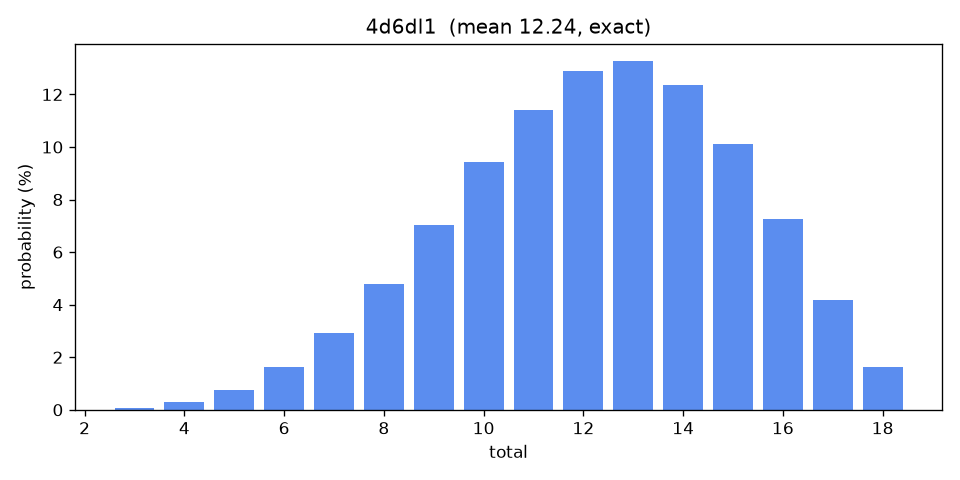

# DiceLab

A dice-notation service that both **rolls** and **reasons**: parse a dice DSL,
simulate seeded rolls, and compute the *exact* probability distribution of any
expression, behind a fully typed, self-documenting API.

## Why Python

- **A parser/evaluator reads cleanly.** The dice DSL (`2d6kh1`, `4d6dl1`,
  `1d20+5 adv`, `6d10>=7`, exploding `3d6!`) is a small language; the tree-walking
  evaluator is compact and explicit.
- **Exact probability is convolution + combinatorics.** NumPy makes the analytic
  distribution (not sampling) fast and clear.
- **FastAPI is the API story.** Pydantic v2 models, automatic OpenAPI docs, and
  precise validation out of the box.

## The distribution of `4d6dl1`



## Quickstart

```bash
uv sync
uv run uvicorn dicelab.api.app:app --reload   # API + Swagger at /docs
uv run dicelab roll 4d6dl1 --seed 42          # CLI, no server needed
uv run dicelab distribution 2d6
```

## Supported notation

`NdM`, keep/drop highest/lowest (`kh`/`kl`/`dh`/`dl`), `+ - *` and parentheses,
advantage/disadvantage (`adv`/`dis`), exploding (`!`), reroll-once (`rX`), and
success pools (`>=`/`<=`).

Keep/drop modifiers apply left to right, each to the dice the previous one kept,
so `4d6kh3kl1` is the lowest of the three highest dice. `kh0` keeps nothing,
`dh0` drops nothing, and a count larger than the pool keeps or drops all of it.
Rolls and exact distributions share this one implementation, so they always agree.

Project status and known issues are in [PROGRESS.md](PROGRESS.md); changes are in
[CHANGELOG.md](CHANGELOG.md).

## Endpoints

| Method | Path            | Purpose                                                   |
|--------|-----------------|-----------------------------------------------------------|
| POST   | `/roll`         | Seeded roll → deterministic kept/dropped dice and total   |
| POST   | `/distribution` | Exact PMF/CDF/mean/variance/percentiles (`method` field)  |
| POST   | `/validate`     | Parse only → AST or a structured error                    |
| GET    | `/healthz`      | Liveness                                                  |

Rolls and distributions accept an optional `successLadder` that maps a result to an
`outcome` (e.g. botch / success / critical), so dice-pool expressions report a verdict
rather than just a count.

## Development

```bash
uv run pytest
uv run ruff check . && uv run ruff format --check .
uv run mypy
uv run python scripts/render_chart.py   # regenerate docs/4d6dl1.png
```

## Docker

```bash
docker build -t dicelab .
docker run --rm -p 8000:8000 dicelab
```
